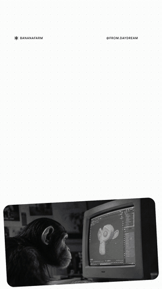

# Slide Motion

A [Claude Code](https://claude.com/claude-code) skill that turns anything you give it into a branded motion-graphics video, rendered locally to MP4. You can give it a topic, a link, a report, a deck, a spreadsheet, photos, or a [Carousel Studio](https://github.com/from-day-dream/Carousel-Studio-Claude-Skill) carousel. **9:16 and 15 seconds by default** (Reels, TikTok, Shorts, Stories), or any aspect ratio and length.

<p>
  
</p>

<sub>One composition, one timeline (15s, 1080×1920), made from a Carousel Studio carousel plus the product's website. The brand's pixel cursor is the throughline:
<br>1. it lands on the chimp's monitor and dives into the screen as the app screens burst out;
<br>2. it walks the three steps, then rides each whip across the cuts;
<br>3. it rides the render-farm bar as it grows to 17×, points at a render, and clicks the link.
<br>Something moves in every frame; only the text pauses to be read.</sub>

- **No built-in style.** The skill holds only the video logic. Colours, fonts, voice, curves, timings and how images or illustrations are treated all come from **your** brand: the kit shared with Carousel Studio, plus how it moves, which you define once at setup.
- **Intentional elements.** Your brand's motifs are used only where they mean something: a cursor appears when something is clicked or dragged, an arrow when there's a direction. Nothing is shown as decoration or out of habit.
- **No preset transitions.** How one idea hands over to the next (a camera move, a morph, a hand-off, a cut…) is chosen for each video, from its content and what you ask for.
- **A video, not a slideshow.** Each video is one HTML composition with one master timeline. It's built from overlapping **sequences**, along a **throughline** that carries the viewer from start to end. Elements live across ideas and transform into each other; cuts are moments inside the timeline, not boundaries between frames.
- **Never still.** An ambient layer and long content motion run under every read moment, and only text pauses, for its reading time. The renderer errors on any stretch where nothing moves.
- **Any source, analysed first.** URLs, PDFs, Word, PowerPoint, Excel, CSV, Markdown, images, folders and carousels, in any mix. Claude writes an analysis (goal, angle, key points, facts with their sources, usable assets) before planning anything. Numbers on screen come from your sources.
- **An image library for every video.** Every image in your sources is pulled in, de-duplicated, measured and put on a numbered contact sheet. Claude then chooses images for relevance, sharpness at the size shown and one consistent look. Images from other people's pages need your yes.
- **Runs locally on your Claude plan.** Silent MP4s; add music in the app you post from.

## How it works

1. **Setup, once.** If Carousel Studio already has your brand, Slide Motion reuses it and only asks how the brand moves:
   - its character, with reference videos you like;
   - what its videos show;
   - its pace and curves.

   Setup starts fresh: motion from earlier videos or other brands isn't reused. Your answers become `motion.json`, plus Motion rules in your design language. A short test render confirms them. Without a brand, it runs the full brand interview first.
2. **`/slide-motion <topic, link, file or carousel>`.** `ingest.mjs` gathers the sources: extracted text, page screenshots and the image library. Claude analyses them, then plans the whole video:
   - the ideas and the throughline;
   - sequences with time ranges;
   - read moments;
   - what keeps moving in each stretch;
   - how ideas hand over.
3. **Compose and render.** Claude writes `composition.html`. A local script seeks its timeline frame by frame in Chromium (with GSAP's MorphSVG, DrawSVG and MotionPath plugins), pipes the frames into ffmpeg, and checks every read moment and the motion as a whole. The same input gives a byte-identical video.
4. **Critique and revise.** Claude reviews the storyboard of read moments, the cut sheet and frames sampled across the video, and fixes what doesn't play as one continuous piece.

## Requirements

- Claude Code
- Node.js 18 or newer
- About 300 MB of disk for Playwright's Chromium and ~80 MB for ffmpeg (installed on first run)

## Install

Clone this folder into a Claude Code skills directory, next to Carousel Studio if you use it:

```bash
# Personal: available in every project
git clone <this repo> ~/.claude/skills/slide-motion

# Or per project
git clone <this repo> .claude/skills/slide-motion
```

> **Windows:** to keep the repo elsewhere, link it with a directory junction (no admin rights needed):
> `mklink /J .claude\skills\slide-motion C:\path\to\slide-motion-skill`

Start a new Claude Code session. npm packages (Playwright, GSAP, ffmpeg-static, sharp) and Chromium install automatically the first time the skill runs, or run `node <skill folder>/scripts/setup.mjs` yourself.

## First run

```
/slide-motion set up how my brand moves
/slide-motion animate my last carousel
/slide-motion https://ourcompany.com/blog/q3-results, 20 seconds
/slide-motion make a reel from ~/Downloads/Q3-report.pdf and pitch.pptx, 1:1
```

Your data lives in the workspace Carousel Studio uses: `./carousel-studio/` in the current project, or wherever `CAROUSEL_STUDIO_HOME` points.

```
carousel-studio/
├── config.json                  active brand (shared)
├── brands/<slug>/               brand kit (shared) + motion.json (how it moves), optional illustrations/ and photos/
├── output/<date>-<topic>/       carousels (Carousel Studio)
├── motion/<date>-<topic>-9x16/  source/ (your sources + extracted text), images/ (the library), composition.html,
│                                video.mp4, poster.png, storyboard.png, cuts.png, meta.json (analysis + plan)
├── motion/index.json
└── gallery.html                 one viewer for carousels and videos
```

## What `motion.json` holds (yours, from setup)

| Field | What |
|---|---|
| `ease.enter / exit / move / fade / ambient / cutOut / cutIn` | Your curves: GSAP eases, `logistic(k)` or `cubic-bezier(…)` (e.g. copied from Figma or After Effects). `.in`/`.out` halves split a move across a cut. |
| `duration.enter / exit / move / cut / stagger`, `distance` | Your pace and travel. |
| `readingSpeed`, `visual` | How long text needs; how many words per read moment; whether a headline is required; whether videos show photos or illustrations. |

A video can adjust any of it for itself in `meta.json → motion`. Transitions aren't stored here; each video's plan chooses its own.

## Aspect ratios

| Ratio | Canvas | For |
|---|---|---|
| **9:16** (default) | 1080×1920 | Reels, TikTok, Shorts, Stories |
| 4:5 | 1080×1350 | Instagram / LinkedIn feed |
| 1:1 | 1080×1080 | Square feed |
| 16:9 | 1920×1080 | YouTube, LinkedIn, websites |

Any other `W:H` works too. In 9:16, text stays out of the zones covered by the platform's UI (top 220px, bottom 420px, right 140px).

## Gallery

```bash
node <skill>/scripts/gallery.mjs --serve
```

Open http://localhost:4173. Videos appear in the **Motion** tab of the gallery Carousel Studio uses. Click a read moment to play from there, use the arrow keys to jump between them, and download the MP4 or any frame.

## Render report checks

Everything Carousel Studio checks, at every read moment (overflow, safe area, minimum size, brand fonts, budgets, hierarchy, emphasis, contrast against the rendered pixels, external URLs, raw colours), plus:

- **Never still:** any stretch over 0.3s where nothing animates is an error.
- **Reading time:** each read moment's text stays still for its words ÷ your reading speed.
- **Your visual rules:** words per read moment, the headline rule, photos or illustrations where your brand expects them.
- **Timeline:** read moments exist, every tween is on the master timeline, every curve name is valid.
- **Images:** a warning when one is shown soft (more than 1.5× its pixels), and an error for third-party images without your approval.
- **Determinism:** no CSS animations, timers, `<video>`, or `Math.random`.
- **Length:** within ±1s of the target (15s, or what you asked for).

## What's in the skill

| Path | Purpose |
|---|---|
| `SKILL.md` | Entry point and workflow |
| `references/video-logic.md` | The core: a video as one piece, sequences, throughline, layers, handover techniques |
| `references/composition.md` | The composition contract: markup, master timeline, labels, checks |
| `references/` (others) | Source analysis, the image library, aspect ratios, from-carousel, brand and motion setup, critique rubric |
| `scripts/render.mjs` | Composition → frames → MP4, poster, storyboard, cut sheet, report; `--draft`, `--ratio`, `--duration`, `--specimen` |
| `scripts/ingest.mjs` | Gather any sources into a video folder: extracted text, page screenshots, `source/INDEX.md`, the image library |
| `scripts/library.mjs` | Rebuild a video's image library after adding images by hand |
| `scripts/from-carousel.mjs` | Carousel sources: content, photos, aesthetic reference |
| `scripts/image.mjs` | Optional photo generation (fal / Atlas / OpenAI, off by default) |
| `scripts/gallery.mjs`, `setup.mjs`, `fonts.mjs` | Gallery, setup and checks, Google Fonts |
| `scripts/lib/` | Shared with Carousel Studio (`workspace`, `render-core`, `serve`), plus motion tokens, curves and plugins (`motion.mjs`), PDF/Office image extraction and the image library |
| `config/` | Canvas sizes and safe zones, image models |
| `templates/` | Empty brand kit (with an empty `motion.json`), a structure-only `composition.html`, the gallery page |
| `examples/bananafarm-mixed-snappy/` | A complete project built from a carousel + website: sources, image library, analysis, plan, composition and video (rendering it needs the user's brand) |

Files under `scripts/lib/` (except `motion.mjs`, `office.mjs`, `pdf-images.mjs`, `library.mjs`), `scripts/fonts.mjs`, `scripts/image.mjs`, `config/providers.json`, `templates/brand/` (except `motion.json`) and `templates/gallery.html` are identical copies of Carousel Studio's, so each skill installs on its own.

## Troubleshooting

- **"has no motion.json" / "motion tokens incomplete"**: run the motion setup ("set up how my brand moves").
- **"brand font failed to load"**: a font file is missing or registered under the wrong family in `tokens.json`. Re-run `scripts/fonts.mjs`.
- **"could not launch Chromium"** or **ffmpeg errors**: run `node <skill>/scripts/setup.mjs`.
- **"nothing moves from Xs to Ys"**: add ambient motion or let content motion run through that stretch.
- **"unknown ease"**: a curve name is misspelt; use a GSAP ease, `logistic(k)` or `cubic-bezier(…)`, optionally with `.in` / `.out`.

## License

MIT, see [LICENSE](LICENSE).
